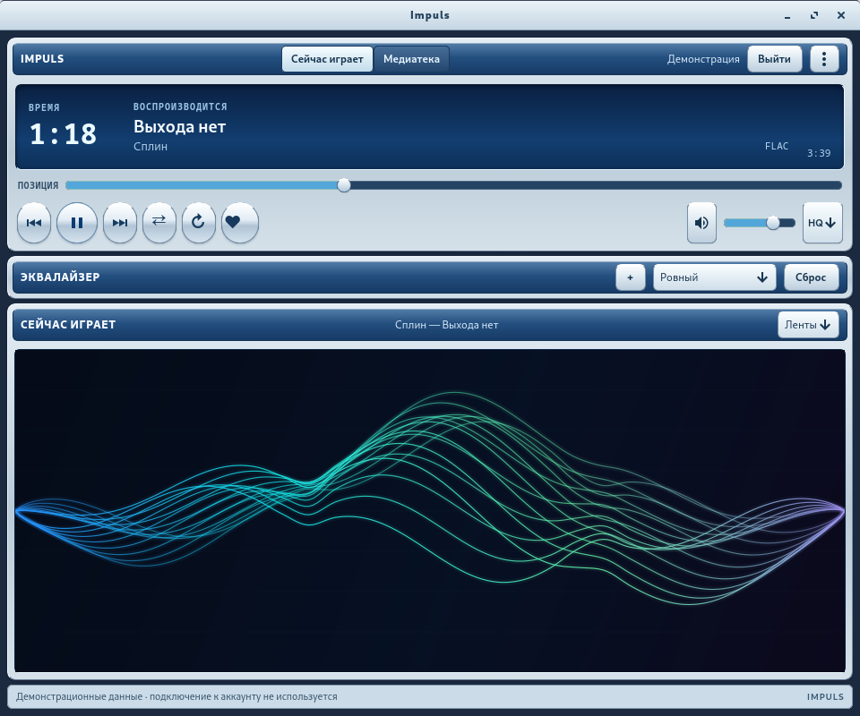
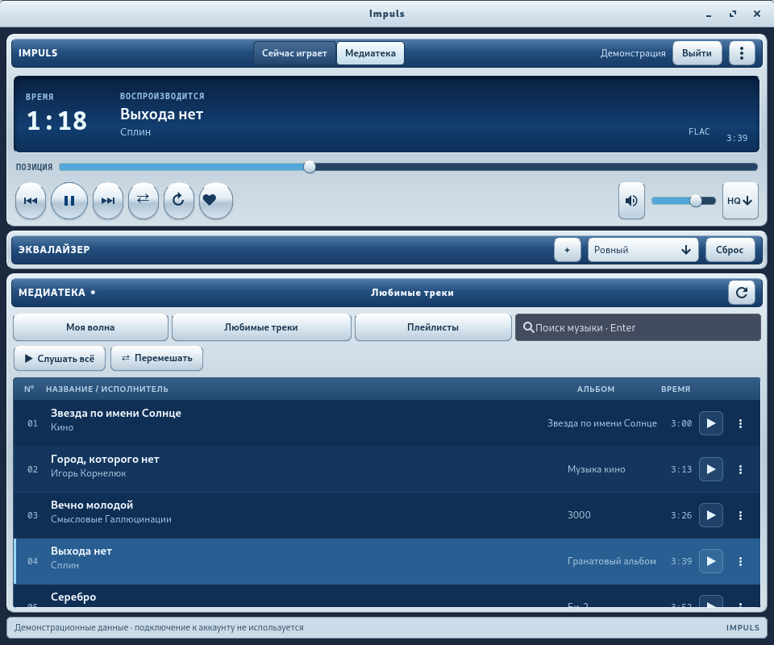

<div align="center">


# Impuls

**Ваша музыка. Знакомый звук нулевых.**

Открытый настольный клиент Яндекс Музыки для Fedora: GTK, GStreamer и интерфейс с настроением старых плееров.

[Скачать RPM](https://github.com/AnoY606-git/Impuls/releases) · [Сообщить об ошибке](https://github.com/AnoY606-git/Impuls/issues) · [Лицензия](LICENSE)

</div>

> **Версия 1.1.0.** Большое обновление интерфейса: серебристое оформление окна, читаемые музыкальные списки, управление из трея, четыре визуализации и сохранение настроек. Коллекция загружается порциями; первые треки доступны до завершения загрузки медиатеки. Неофициальный API может измениться без предупреждения.





## Возможности

- Обновлённый ретро-интерфейс: собственный заголовок окна с системными оконными действиями, серебристые панели, синий дисплей, крупные кнопки и двухстрочные названия треков. При ширине менее 680 px колонка альбома скрывается, а в компактном окне громкость и качество переносятся на отдельную строку. Минимальный размер — 480×360; при нехватке высоты доступна прокрутка.
- Трей StatusNotifierItem с меню: показать плеер, предыдущий трек, воспроизведение/пауза, следующий трек и выход. При доступном хосте трея закрытие окна сохраняет воспроизведение; если хост исчезает, скрытое окно появляется снова.
- Обновление текущего списка с повторным получением данных из API без остановки звучащего трека; кнопки «Слушать всё» и «Перемешать» для текущего списка.
- Отключение звука с восстановлением прежней громкости; меню действий трека позволяет скопировать название с исполнителем и открыть его страницу в Яндекс Музыке.
- Автоматическое сохранение громкости, качества, десяти полос эквалайзера и выбранной визуализации в `~/.config/impuls/settings.json` (или `$XDG_CONFIG_HOME/impuls/settings.json`). В этом файле нет токенов и данных аккаунта.

- Поиск треков, любимые треки и просмотр своих плейлистов.
- Воспроизведение, пауза, перемотка, громкость, случайный порядок и повтор текущего списка.
- Автоматическая подгрузка коллекции при прокрутке без ожидания загрузки всей медиатеки.
- Подготовка следующего трека в RAM после подтверждённой полной загрузки текущего: максимум один трек до 64 МиБ, без постоянного аудиокеша. При неудачной подготовке используется обычное потоковое воспроизведение.
- Выбор экономичного, высокого и Lossless-качества. Плеер показывает фактически полученный формат и битрейт; FLAC доступен, если сервис отдаёт его для данного трека и аккаунта. Изменение применяется со следующего трека и обновляет его предзагрузку.
- Восстановление зависшего потока: если при активном воспроизведении позиция не меняется 12 секунд, плеер заново получает ссылку и продолжает тот же трек с сохранённой позиции. После двух неудачных попыток он останавливается и показывает ошибку.
- «Моя волна»: загрузка следующих треков и обратная связь о прослушивании и пропусках. Перемешивание и повтор списка действуют в медиатеке, а не меняют порядок рекомендаций волны.
- Добавление и удаление трека в разделе «Мне нравится».
- Десятиполосный эквалайзер GStreamer с готовыми пресетами и ручной настройкой.
- Четыре визуализации на основе реального спектра звука: сглаженные светящиеся «Ленты», столбцы «Спектр», «Зеркало» и «Орбита». В тишине анимация прекращается, выбор режима сохраняется.
- Системные медиаклавиши и управление через MPRIS; Ctrl+F открывает поиск, Ctrl+←/→ переключает треки, пробел управляет паузой вне полей ввода.
- Вход по одноразовому коду Яндекса; ввод существующего токена доступен как запасной вариант.
- Необязательное сохранение входа в системном хранилище Secret Service, например в совместимом GNOME Keyring или KWallet.

Доступность треков и потокового воспроизведения зависит от аккаунта, региона и условий подписки. Это независимый проект: он не связан с Яндексом. Для работы нужен доступ к интернету и действующий аккаунт.

Пока нет загрузки для офлайна, редактирования плейлистов, текстов песен, подкастов и аудиокниг. Доступный формат потока определяется сервисом и установленными кодеками: запрос Lossless иногда возвращает AAC или MP3, и интерфейс это отображает. Потоковое воспроизведение FLAC и его предзагрузка проверены на действующем аккаунте; повторный вход по коду и «Моя волна» после этих изменений отдельно не проверялись на нём.

Предзагрузка уменьшает сетевые задержки при переходе, но не гарантирует бесшовный стык или кроссфейд. Если следующий файл больше 64 МиБ или не успел загрузиться, он воспроизводится обычным потоком. Текущий поток буферизуется в памяти в пределах 64 МиБ; после перемотки подготовка следующего может быть пропущена, если нельзя подтвердить получение текущего файла целиком. Автоматическое восстановление проверено на искусственном обрыве передачи; причина каждого сбоя сети или аудиоустройства может различаться.

## Установка

1. Скачайте `impuls-*.noarch.rpm` со страницы [Releases](https://github.com/AnoY606-git/Impuls/releases).
2. В папке с загруженным файлом выполните:

   ```bash
   sudo dnf install ./impuls-*.noarch.rpm
   ```

3. Запустите **Impuls** из меню приложений или командой `impuls`.

Сборка подготовлена для Fedora 45; совместимость с другими версиями Fedora ещё не проверена. Пакет **не подписан** ключом проекта. Чтобы проверить контрольную сумму скачанного файла, сохраните рядом `SHA256SUMS` со страницы выпуска и выполните `sha256sum -c --ignore-missing SHA256SUMS`. Сумма обнаруживает повреждение файла, но сама по себе не подтверждает его происхождение.

Если политика RPM на вашей системе требует обязательную подпись и DNF отказывает в установке, сначала установите зависимости из репозиториев Fedora, а затем разрешите установку неподписанного пакета только для этой команды, сохранив проверку его внутренних контрольных сумм:

```bash
sudo dnf install python3 python3-gobject python3-cairo python3-requests python3-pysocks python3-typing-extensions \
  gtk4 gobject-introspection adwaita-icon-theme gstreamer1 gstreamer1-plugins-base gstreamer1-plugins-good \
  gstreamer1-plugins-bad-free glib-networking libsecret
sudo rpm --define '_pkgverify_level digest' -Uvh ./impuls-*.noarch.rpm
```

Это не меняет политику RPM для остальных пакетов. Используйте этот способ, только если доверяете источнику скачанного RPM.

## Управление окном и треем

Меню ⋮ открывает справку по сочетаниям клавиш, сворачивание в трей и полный выход. Стандартные кнопки заголовка сворачивают и разворачивают окно; закрытие прячет плеер только при доступном трее. «Выйти из плеера» и команда выхода в меню трея завершают воспроизведение и приложение. Кнопка «Выйти» рядом с именем аккаунта завершает вход в Яндекс Музыку.

Для трея нужен совместимый StatusNotifierHost (например, панель KDE Plasma). В GNOME может потребоваться расширение с поддержкой AppIndicator/StatusNotifierItem. Без хоста действие «Свернуть в трей» недоступно, а закрытие окна завершает приложение. Проверка протокола выполнена с отдельной D-Bus-сессией и тестовым хостом; внешний вид меню в конкретной панели зависит от рабочего стола.

Эквалайзер раскрывается кнопкой +. Ручной выбор видимости сохраняется при изменении размера окна. Ctrl+R обновляет текущий раздел, Ctrl+F открывает поиск, Ctrl+←/→ переключает треки; остальные сочетания доступны в меню справки.

## Первый вход

Нажмите **«Войти» → «Войти по коду»**, откройте предложенную страницу Яндекса и подтвердите вход одноразовым кодом. Пароль Яндекса вводится только на странице Яндекса. Если кодовый вход недоступен, можно вручную ввести уже имеющийся токен; не отправляйте его другим людям.

Флажок **«Запомнить вход»** по умолчанию выключен. Если включить его, токен сохраняется в системном Secret Service; открытый файл с токеном не создаётся. Без рабочего хранилища вход можно использовать только в текущем сеансе. Кнопка **«Выйти»** удаляет сохранённый токен из хранилища, но не отзывает его на стороне Яндекса.

У Impuls нет собственного сервера, рекламы и встроенной аналитики. Сетевые запросы выполняются к Яндексу и его инфраструктуре через неофициальную библиотеку. Приложение не проходило независимый аудит безопасности.

## Сборка из исходников

```bash
sudo dnf install git rpm-build redhat-rpm-config python3 python3-gobject python3-cairo \
  python3-requests python3-pysocks python3-typing-extensions gtk4 gobject-introspection gstreamer1 \
  gstreamer1-plugins-good libsecret curl tar gzip

git clone https://github.com/AnoY606-git/Impuls.git
cd Impuls
./scripts/build-rpm.sh
```

Готовые бинарный и исходный RPM, а также `SHA256SUMS` появятся в `dist/`. Скрипт скачивает зафиксированную версию библиотеки `yandex-music` с PyPI, проверяет SHA-256 и включает её исходный код и лицензию в пакет. При наличии заранее скачанного wheel можно указать `IMPULS_WHEEL=/путь/к/yandex_music-3.2.2-py3-none-any.whl`.

Проверки без обращения к аккаунту:

```bash
python3 -m unittest discover -s tests -v
```

Часть тестов графического интерфейса и MPRIS требует графического дисплея и сессионной D-Bus; проверки совместимости моделей требуют `yandex-music` 3.2.2. Без этих компонентов соответствующие тесты пропускаются. Для полного прогона установите `python3-pip`, `dbus-daemon`, `xorg-x11-server-Xvfb` и `xorg-x11-xauth`, затем выполните:

```bash
python3 -m venv --system-site-packages .venv
.venv/bin/python -m pip install 'yandex-music==3.2.2'
GTK_A11Y=none GDK_BACKEND=x11 IMPULS_TEST_DBUS=1 \
  dbus-run-session -- xvfb-run -a .venv/bin/python -m unittest discover -s tests -v
```

## Похожие проекты

При проектировании изучены [YaMusic](https://github.com/andfriden/YaMusic), [YamSync](https://github.com/audiz/YamSync), [ya-namp](https://github.com/lifeart/ya-namp) и [Cassette](https://altlinux.space/rirusha/Cassette). У этих проектов собственные интерфейсы и наборы функций; Impuls делает ставку на нативный GTK-интерфейс в стиле плееров нулевых.

## Лицензия и компоненты

Собственный код Impuls распространяется на условиях **GPL-3.0-only**. Полный текст: [LICENSE](LICENSE). Copyright © 2026 AnoY606-git and Impuls contributors.

Клиент использует [yandex-music](https://github.com/MarshalX/yandex-music-api) 3.2.2 под лицензией **LGPL-3.0-only**; её текст и исходные Python-файлы включены в RPM. GTK, GStreamer и остальные системные зависимости распространяются отдельно, на условиях их авторов. Название Яндекса используется только для указания совместимого сервиса.
