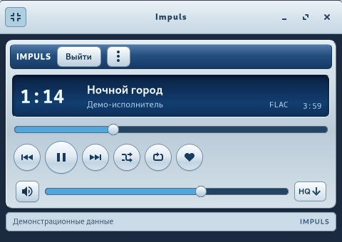
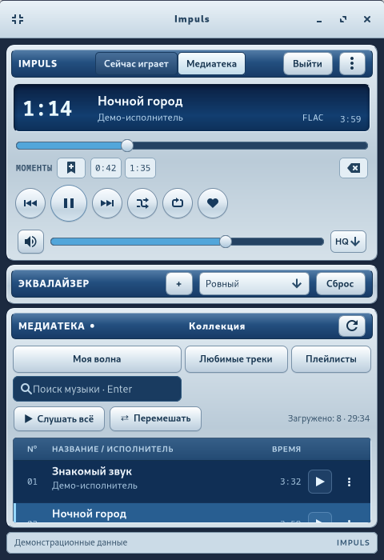
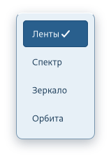
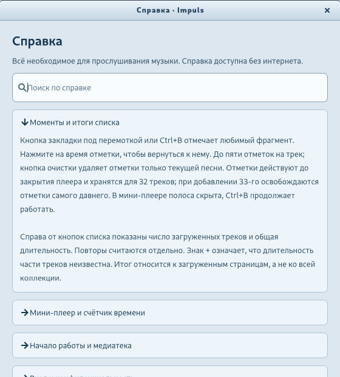

<div align="center">


# Impuls

**Яндекс Музыка в отдельном плеере с настроением нулевых.**

Для Fedora 45 · Версия 1.3.0

[Скачать](https://github.com/AnoY606-git/Impuls/releases) · [Сообщить о проблеме](https://github.com/AnoY606-git/Impuls/issues) · [Лицензия](LICENSE)

</div>

Impuls позволяет слушать «Мою волну», любимые треки и свои плейлисты без
открытой вкладки браузера. Здесь есть эквалайзер, визуализация музыки,
мини-плеер и управление с клавиатуры.


Все скриншоты сделаны в приложении на демонстрационных данных.

## Установка

1. Откройте [страницу выпусков](https://github.com/AnoY606-git/Impuls/releases)
   и скачайте файл `impuls-…noarch.rpm`.
2. Откройте терминал в папке с этим файлом и выполните:

   ```bash
   sudo dnf install ./impuls-*.noarch.rpm
   ```

3. Найдите **Impuls** в меню приложений или запустите командой `impuls`.

Пакет подготовлен для Fedora 45. Для прослушивания нужны интернет и аккаунт
Яндекса; доступность музыки зависит от региона и условий подписки.

<details>
<summary>Если установка останавливается из-за отсутствия подписи RPM</summary>

Пакет пока не подписан ключом проекта. Если вы доверяете скачанному файлу,
установите зависимости, а затем разрешите установку без подписи только для
этой команды:

```bash
sudo dnf install python3 python3-gobject python3-cairo python3-requests python3-pysocks \
  python3-typing-extensions gtk4 gobject-introspection adwaita-icon-theme \
  gstreamer1 gstreamer1-plugins-base gstreamer1-plugins-good \
  gstreamer1-plugins-bad-free glib-networking libsecret
sudo rpm --define '_pkgverify_level digest' -Uvh ./impuls-*.noarch.rpm
```

Общая политика проверки пакетов от этого не меняется. Если рядом с RPM
скачан файл `SHA256SUMS`, проверить целостность можно командой
`sha256sum -c --ignore-missing SHA256SUMS`. Такая проверка обнаруживает
повреждение файла, но не подтверждает его происхождение.

</details>

## Первый запуск

1. Нажмите **«Войти»**. Если хотите входить автоматически, отметьте
   **«Запомнить вход в системном хранилище»**.
2. Выберите **«Войти по коду»**.
3. Откройте предложенную страницу Яндекса и подтвердите вход полученным кодом.
   Пароль вводится на странице Яндекса.

Вход сохранится в системной связке ключей — например, GNOME Keyring или
совместимом KWallet. Без этой отметки он действует только до закрытия плеера.
Ввод уже имеющегося токена доступен в том же окне как запасной способ.

## Как слушать музыку

- **«Моя волна»** запускает персональные рекомендации и подбирает следующие треки.
- **«Любимые треки»** открывает вашу коллекцию «Мне нравится».
- **«Плейлисты»** показывает ваши плейлисты. Выберите один, чтобы увидеть треки.
- **Поиск**: введите исполнителя или название и нажмите Enter.
- **«Слушать всё»** запускает открытый список с начала, **«Перемешать»** — в
  случайном порядке. Коллекция подгружается по мере прокрутки.
- **Сердце** открывает добавление текущего трека в любимое и удаление из него.
  Кнопка **⋮** в строке трека позволяет скопировать название или ссылку,
  а также открыть трек в Яндекс Музыке.

Круглые кнопки под дисплеем переключают треки и управляют паузой, перемешиванием
и повтором. Перемешивание и повтор списка не меняют порядок «Моей волны».
Ползунок под дисплеем отвечает за позицию в треке, справа — за громкость.
Нажмите значок динамика, чтобы временно выключить звук.

## Настройка звука

**Качество.** Рядом с громкостью выберите экономичное, высокое или Lossless.
Выбор применяется со следующего трека. Под названием композиции показывается
полученный формат: например, FLAC или AAC. Если сервис не отдаёт FLAC для
этого трека и аккаунта, плеер использует доступный вариант.

**Эквалайзер.** Нажмите **+** в строке «Эквалайзер», выберите готовый пресет
или настройте десять полос вручную. Кнопка **«Сброс»** возвращает ровный звук.

**Визуализация.** Откройте **«Сейчас играет»** и выберите «Ленты», «Спектр»,
«Зеркало» или «Орбита». Рисунок следует за музыкой, а в тишине останавливается.


Громкость, качество, эквалайзер и выбранная визуализация сохраняются автоматически.

## Удобные мелочи

- **Мини-плеер.** Нажмите кнопку слева в заголовке окна или Ctrl+Shift+M.
  Останутся трек, перемотка и основные кнопки. Повторное нажатие вернёт полное окно.
- **Любимый момент.** Нажмите закладку под перемоткой или Ctrl+B, чтобы запомнить
  место в треке. Нажатие на появившееся время вернёт к этому месту. Можно оставить
  до пяти отметок на трек. Плеер помнит последние 32 трека с отметками
  до конца текущего сеанса.
- **Прошло или осталось.** Нажмите на крупный счётчик времени, чтобы переключить его.
- **К играющему треку.** Ctrl+J находит текущую композицию в открытом списке.
- **Таймер сна.** В меню приложения выберите 15, 30 или 60 минут. Музыка остановится
  по окончании отсчёта; там же можно отменить таймер.
- **Итоги списка.** Над треками видны число загруженных композиций и их общая
  длительность. Знак `+` означает, что длительность части треков пока неизвестна.



Окно можно уменьшить: элементы перестроятся, а колонка альбома скроется, чтобы
оставить место названиям. Размер полного окна тоже запоминается.

<details>
<summary>Компактное окно, выбор визуализации и встроенная справка</summary>







</details>

## Клавиатура и работа в фоне

| Клавиши | Действие |
| --- | --- |
| Пробел | Воспроизведение / пауза, когда вы не вводите текст |
| Ctrl+← / Ctrl+→ | Предыдущий / следующий трек |
| Alt+← / Alt+→ | Перемотка на пять секунд |
| Ctrl+↑ / Ctrl+↓ | Громкость |
| Ctrl+M | Выключить / включить звук |
| Ctrl+F | Поиск |
| Ctrl+R или F5 | Обновить список |
| Ctrl+B | Запомнить момент |
| Ctrl+J | Перейти к играющему треку |
| Ctrl+Shift+M | Мини-плеер / полное окно |
| F1 | Справка |
| Ctrl+Q | Выйти из плеера |

Impuls поддерживает системные медиаклавиши. Если на рабочем столе доступен
трей, закрытие окна оставляет музыку играть: вернуть плеер можно через его
значок. Для полного выхода используйте Ctrl+Q или **меню приложения → «Выйти из Impuls»**.
Кнопка **«Выйти»** рядом с именем завершает вход в аккаунт.

## Если что-то не получается

**Нет звука.** Проверьте громкость и выбранное устройство в системном микшере.
Если недоступен отдельный трек, проверьте его в Яндекс Музыке.

**Список не обновляется.** Нажмите кнопку обновления в заголовке медиатеки
или Ctrl+R и проверьте соединение с интернетом.

**Не работают эквалайзер или визуализация.** Установите пакет
`gstreamer1-plugins-good` и перезапустите Impuls.

**Не запоминается вход.** Проверьте, что системная связка ключей запущена
и разблокирована. При недоступном хранилище можно войти на текущий сеанс.

**Музыка выключается при закрытии окна.** Рабочий стол не показывает значки
приложений в трее. В GNOME для этого может потребоваться расширение
AppIndicator; без него плеер завершает работу вместе с окном.

Меню приложения находится справа в верхней панели, рядом с кнопкой входа.
В нём есть **«Справка и о программе»** — она работает без интернета.
Если проблема повторяется, [создайте сообщение об ошибке](https://github.com/AnoY606-git/Impuls/issues):
укажите версию Impuls, систему и шаги, после которых она возникает.
Не прикладывайте токены и другие данные для входа.

## Что ещё стоит знать

Impuls — независимый проект, не связанный с Яндексом. Он использует
неофициальный API, поэтому изменения сервиса могут влиять на работу плеера.
Собственного сервера, рекламы и встроенной аналитики у приложения нет.

Скачивание для офлайна, редактирование плейлистов, тексты песен, подкасты
и аудиокниги пока не поддерживаются. Предзагрузка помогает быстрее переключать
треки, но не гарантирует воспроизведение без пауз между ними.

## Для разработчиков

Запуск из исходников, тесты и сборка RPM описаны в
[руководстве разработчика](docs/DEVELOPMENT.md).

## Лицензия

Код Impuls распространяется под **GPL-3.0-only**: [полный текст лицензии](LICENSE).
Copyright © 2026 AnoY606-git and Impuls contributors.

Используется библиотека [yandex-music](https://github.com/MarshalX/yandex-music-api)
3.2.2 под **LGPL-3.0-only**. Её исходники и лицензия включены в RPM;
GTK, GStreamer и другие системные компоненты распространяются отдельно.
